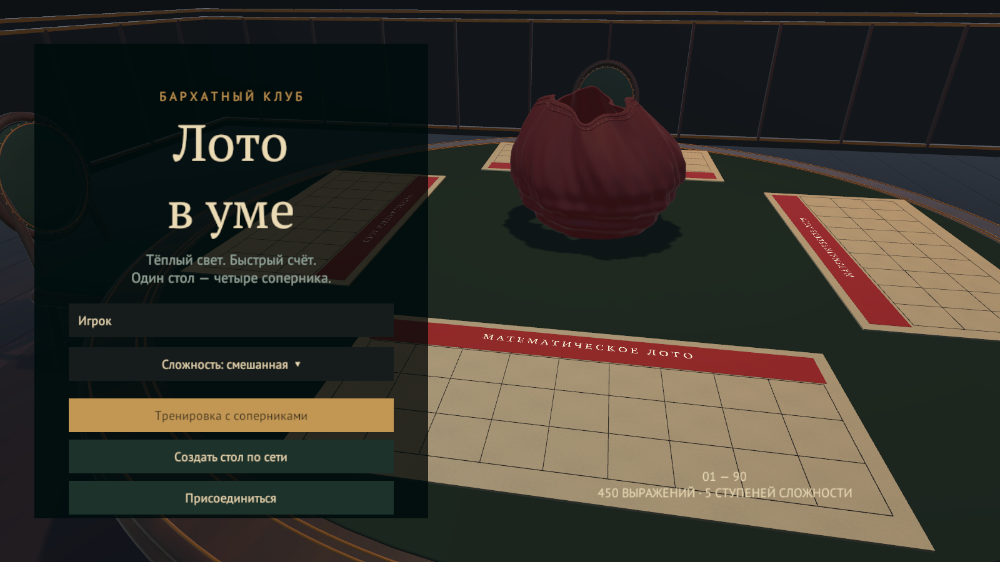
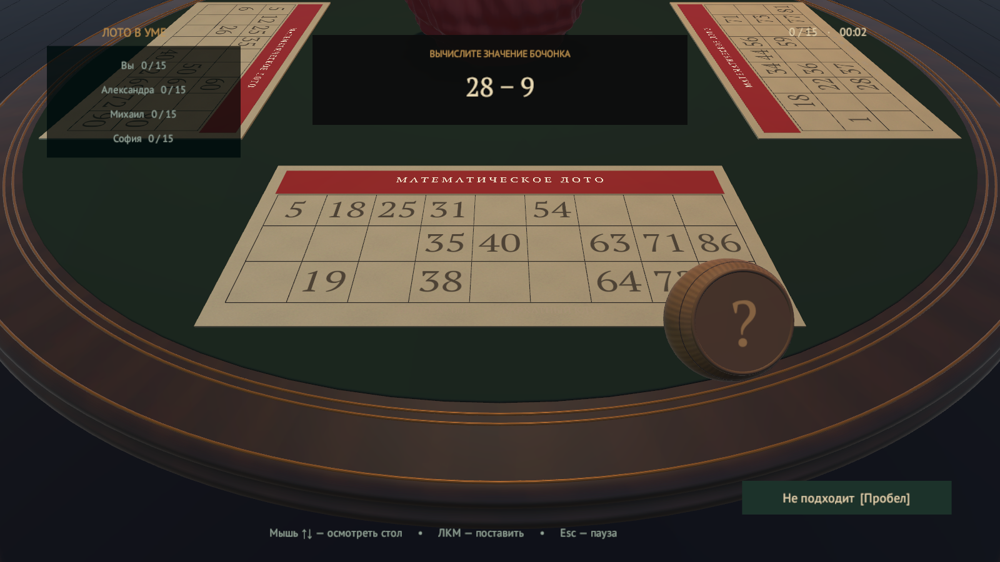
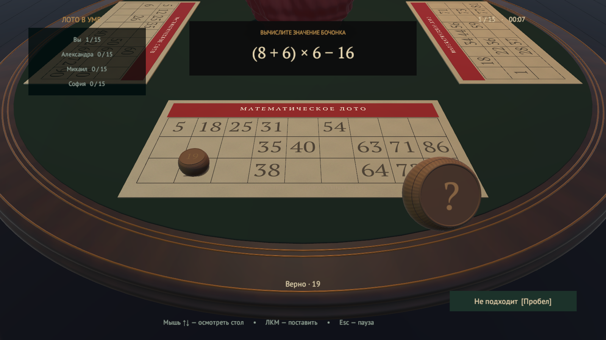

# LOTTO · Лото в уме

**Реши пример. Найди число. Закрой билет быстрее остальных.**

Математическое лото от первого лица: круглый стол на четверых, деревянные бочонки, бархатный мешок и гонка до полного билета. Играйте с друзьями по локальной сети или тренируйтесь с тремя компьютерными соперниками.

**[⬇ Скачать игру для Windows](https://github.com/BurimBasic/Lotto/releases/latest/download/LOTTO-Windows-x64.zip)** · [Все версии](https://github.com/BurimBasic/Lotto/releases) · [Исходный проект](https://github.com/BurimBasic/Lotto/archive/refs/heads/main.zip)

## Скачать и запустить

1. Скачайте **[LOTTO-Windows-x64.zip](https://github.com/BurimBasic/Lotto/releases/latest/download/LOTTO-Windows-x64.zip)**.
2. Полностью распакуйте архив в отдельную папку.
3. Запустите **`VelvetLoto.exe`** из распакованной папки.

**Unity устанавливать не нужно.** Папка `VelvetLoto_Data`, библиотеки и остальные файлы должны оставаться рядом с игрой. Не запускайте `.exe` прямо из архива.

Готовая сборка рассчитана на **Windows x64**. Интерфейс и правила — на русском языке.

## Что внутри

| | |
|---|---|
| **450 выражений** | Для каждого числа от 1 до 90 — пять разных выражений, от сложения до коротких примеров со скобками, квадратами и корнями. |
| **Четыре режима сложности** | Лёгкий, средний, сложный и смешанный. Ответы — целые числа; самый длинный пример занимает 17 символов. |
| **Стол на четверых** | Тренировка с ботами или партия по локальной сети для 2–4 человек. |
| **Свой мешок у каждого** | Внешне мешок общий, но очереди чисел независимы. Пропущенное нужное число вернётся в следующем круге. |
| **Вид от первого лица** | Курсор виден, камера мягко следует за мышью, преимущественно вверх и вниз. |
| **Предметы и звук** | Бочонок подлетает из мешка и переворачивается при постановке. Клетка постепенно обводится красным под короткий звук настоящего карандаша. |

## Как играть

В начале партии каждый получает билет **3×9**: по пять чисел в строке, всего пятнадцать.

Сверху появляется выражение, а перед вами — бочонок со знаком вопроса. Решите пример в уме, опустите взгляд на билет и нажмите нужное число. Верный бочонок перевернётся стороной с ответом и закроет клетку.

Если подходящего незакрытого числа нет, уберите бочонок. Ошибочная постановка тоже убирает его, не закрывая клетку и не показывая ответ. Каждое число снова появится в следующем круге личного мешка.

**Побеждает первый, кто закроет все пятнадцать чисел.**

## Управление

| Действие | Управление |
|---|---|
| Осмотреть стол | Мышь вверх / вниз; небольшой поворот в стороны |
| Поставить бочонок | Левая кнопка по числу своего билета |
| Убрать бочонок | **Пробел** или кнопка «Не подходит» |
| Правила, звук, выход к меню | **Esc** |
| Закрыть игру | Кнопка закрытия окна или **Alt+F4** |

Звук карандаша тихий и короткий. При быстром скольжении по клеткам он не включается, а частые повторные срабатывания ограничены.

## Игра с друзьями

Каждому участнику нужен свой компьютер с одинаковой версией игры. Подключите компьютеры к одной локальной сети.

1. Ведущий выбирает **«Создать стол по сети»**.
2. Остальные выбирают **«Присоединиться»** и вводят показанный ведущему локальный IPv4-адрес.
3. Когда все подключились, ведущий нажимает **«Начать партию»**.

Используется **TCP-порт 28741**. Если Windows спрашивает о доступе игры к частной сети, разрешите его для сетевой партии. Если у ведущего показано несколько адресов, выбирайте адрес вашей общей локальной сети.

В тренировке меню паузы приостанавливает соперников. В сетевой игре партия продолжает идти.

## Скриншоты

Все изображения ниже сняты в игре.

| Партия за столом | Верный бочонок на билете |
|---|---|
|  |  |

## Текущая версия

Это первая публикуемая игровая версия. Поддерживаются тренировка и локальная сеть. Интернет-подбор соперников, пароль комнаты, переподключение и сохранение незаконченной партии пока не реализованы.

Включён облегчённый режим с начальным разрешением до **1280×720** и пределом **60 кадров/с**. Последняя сборка содержит исправленные направления стульев и чисел на бочонках, повторное использование объектов и короткую обводку без частого повторения звука.

## Для разработчиков

Исходный Unity-проект находится в корне репозитория. Откройте папку в **Unity Hub → Add project from disk**, выберите **Unity 6000.3.2f1**, откройте `Assets/Scenes/Salon.unity` и нажмите **Play**. Сцена и интерфейс создаются при запуске.

- [Открытие, сборка и упаковка проекта](docs/DEVELOPMENT.md)
- [Таблица всех 450 выражений](<450 выражений.csv>)
- [Авторы и сторонние материалы](CREDITS.md)

Модели стола, стула, мешка и бочонка созданы в Blender. Редактируемые `.blend`, сценарий их генерации, экспортированные FBX, текстуры и игровые скрипты входят в репозиторий.
